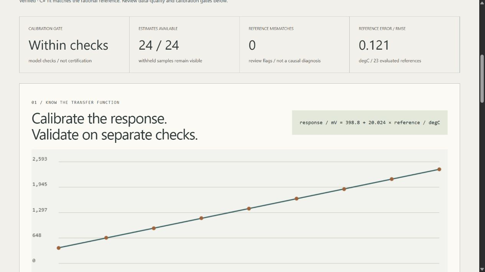

# Scientific Sensor Calibration Lab · DATUM

An offline calibration workbench by **Jason Stys**. Fit a fictional instrument's response, propagate uncertainty, validate on separate check records, inspect changing offsets and keep missing/saturated data explicit. A C# weighted-fit kernel is checked against a separately implemented exact-rational Python reference on every report.



## Run it

[Download a portable release](https://github.com/JasonStys/scientific-sensor-calibration-lab/releases), verify its adjacent SHA-256 checksum, and extract the **whole** ZIP. Launch `ScientificSensorCalibrationLab` (Windows:`.exe`) to open the local browser UI. Keep `_internal` with the executable; Ctrl+C in its console stops it. Portable apps include Python and the C# runtime: no developer setup, account, Docker, elevation or public hosting is required. Releases target desktop Windows x64, Linux x64 and macOS arm64—not every OS/version or native mobile installation. Builds are unsigned: follow OS/organization policy and do not disable security protections.

Source setup requires Python3.12–3.14, Node24 and the stable .NET SDK in `global.json`:

```text
python -m venv .venv
# Activate the environment using the command for your shell.
python -m pip install --require-hashes -r requirements-dev.lock
dotnet restore calibration-core --locked-mode
dotnet build calibration-core -c Release --no-restore
npm ci
npm run build
python -m sensorlab serve
```

## Features and engineering evidence

- Known-response-variance linear calibration: coefficients, covariance, residuals and reduced chi-square, without silently rescaling uncertainties to hide misfit.
- Six synthetic scenarios: stable response, unequal uncertainty, changing offset, electronics clipping/range, missing data and unsupported nonlinearity.162 finite control combinations.
- Separate fit/check/monitoring records. Checks and monitoring references never influence fit coefficients. Reference-mismatch flags are evidence for human review, not a causal fault diagnosis.
- Explicit withheld estimates for missing/saturated signals, insufficient calibration/span, near-zero sensitivity, inconsistent fit, failed checks, expired calibration and extrapolation.
- Combined **standard** uncertainty from first-order inverse propagation, with assumptions and omitted sources visible—not a certified confidence interval.
- TypeScript/HTML/CSS/Canvas browser UI, keyboard/mobile layout, hourly inspection, help and creator contact links.
- Full JSON evidence, inert HTML, sample CSV, replayable strict input and opt-in immutable SQLite history.
- Cross-platform tests, pinned tools/Actions, three-language CodeQL, independently verified native fit and portable app acceptance. No Actions artifact/cache uploads.

The default synthetic case fits `response/mV = 398.8 + 20.024 × reference/degC`; all24 samples receive estimates,23 have supplied evaluation references, and their corrected RMSE is approximately0.12142degC. These are invented demonstration results, not an instrument specification. The nonlinear case deliberately fails fit adequacy; rejected estimates do not become a misleading zero RMSE. See [case contracts](docs/reports/benchmark.json).

```text
python -m sensorlab export --format input --output editable.json
python -m sensorlab export --input editable.json --output evidence.json --history private.sqlite3
python -m sensorlab export --scenario sensor-drift --format csv --output samples.csv
```

Outputs are create-only. SQL history is explicit, local and unencrypted; it caps unique reports at100 and never prunes automatically. Do not use confidential instrument/facility data in this educational project.

## Verify

```text
dotnet build calibration-core -c Release --no-restore
dotnet format whitespace calibration-core --no-restore --verify-no-changes
dotnet calibration-core/bin/Release/net10.0/CalibrationCore.dll --self-test
python -m ruff check sensorlab tests tools launcher.py
python -m ruff format --check sensorlab tests tools launcher.py
python -m mypy sensorlab
python tools/verify_repo.py
python -m pytest --cov=sensorlab --cov-report=term-missing
python -m tools.benchmark
npm run format:check
npm test
npm run build
npx playwright install chromium firefox webkit
npm run test:e2e
npm run audit
python -m pip_audit --disable-pip --no-deps -r requirements-dev.lock
python tools/package_app.py
```

Main files: `calibration-core/Program.cs` provides the bounded native fit/parser/self-tests; `sensorlab/model.py` builds and validates inputs; `reference.py` solves exact rational normal equations; `engine.py` compares fits, propagates uncertainty and gates samples; `reports.py` exports/stores evidence; `server.py` confines read-only HTTP; `__main__.py` provides CLI. `web/main.ts` renders charts/inspection, `contracts.ts` validates display data, and `tools/` provides measured regression, inventory and portable-release gates. Every file and exact function/variable location is described in the generated indexes.

[User guide](docs/USER_GUIDE.md) · [Model and primary research](docs/MODEL.md) · [Architecture](docs/ARCHITECTURE.md) · [API/schema](docs/API.md) · [Validation results](docs/VALIDATION.md) · [Release/rollback](docs/RELEASE.md) · [File catalog](docs/FILE_CATALOG.md) · [Code index](docs/CODE_INDEX.md) · [Security](SECURITY.md) · [Notices](docs/THIRD_PARTY.md)

## Boundaries and contact

Synthetic scientific education only. No real hardware collection/control, accredited calibration, physical traceability, certified coverage interval, arbitrary nonlinear curves, reference-input uncertainty, correlated noise, automatic causal drift diagnosis or safety-critical use. An internally verified computation can still describe the wrong real-world model. Do not calibrate/qualify real equipment from these invented examples.

Created by [Jason Stys](https://github.com/JasonStys). [Questions/issues](https://github.com/JasonStys/scientific-sensor-calibration-lab/issues) · [LinkedIn](https://www.linkedin.com/in/jason-stys-31b30b351/). No government, employer, laboratory or equipment-vendor endorsement. MIT source; retain bundled runtime notices.
